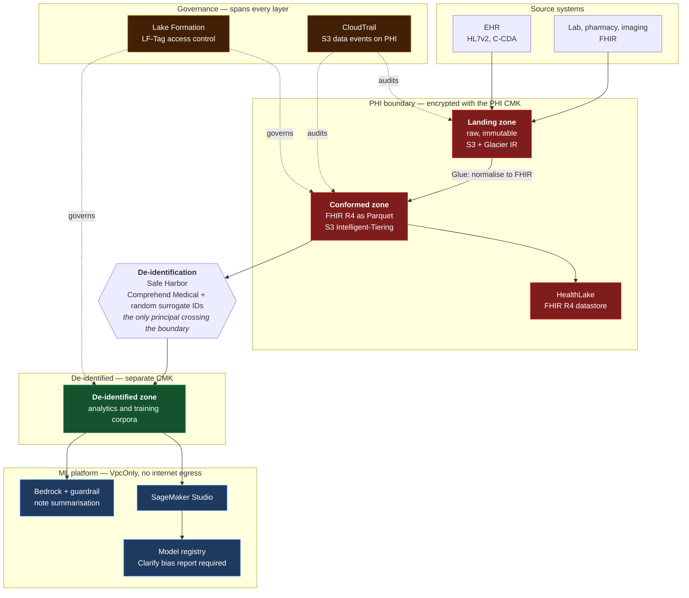

# Clinical Data Platform for AI/ML — Reference Architecture

A deployable reference architecture for a HIPAA-aligned clinical data lake on AWS, built so that data science can proceed against clinical data without any data scientist holding access to PHI.

Four CloudFormation layers, validated in CI by cfn-lint and Checkov, with the design decisions and their trade-offs recorded as ADRs.

[](https://github.com/mmoideen/hcls-clinical-data-platform/actions/workflows/iac-validate.yml)

---

## The problem

A regional health system wants to use its own clinical data for two things: predicting 30-day unplanned readmissions, and reducing the documentation burden on clinicians through note summarisation. Both are well-understood applications. Neither is blocked by modelling difficulty.

They are blocked by data access.

Clinical data sits in the EHR behind HL7v2 interfaces. Every analytics request becomes a bespoke extract. Because those extracts contain PHI, every one needs individual review, and the review queue is measured in weeks. The practical outcome is that the data science team spends most of its time waiting for data, and the compliance team spends most of its time reviewing requests that are individually low-risk but collectively unbounded.

The architecture below attacks the access problem rather than the modelling problem, because that is what is actually in the way.

**The core move:** make de-identification a pipeline stage rather than a per-request process. A governed de-identified zone is produced continuously and automatically. Data scientists are granted access to that zone and nothing else — not by policy, but by a role that holds no key material capable of decrypting PHI. The compliance question shifts from "should this person see this extract" to "is the de-identification pipeline correct", which is asked once and audited continuously.

### Illustrative business case

Figures are modelled, not measured, and the assumptions are stated so they can be argued with.

| Assumption | Value |
|---|---|
| Annual Medicare inpatient revenue | $180M |
| Current HRRP readmission penalty | 1.2% |
| Penalty reduction attributed to earlier risk identification | 40% |
| Clinical FTEs affected by documentation burden | 320 |
| Shifts per clinician per year | 156 |
| Documentation time reclaimed per clinician per shift | 20 min |
| Loaded clinical hourly cost | $95 |
| Data requests per year currently requiring manual de-identification review | 140 |
| Compliance analyst hours per request | 6 |

| Outcome | Modelled annual value |
|---|---|
| Reduced HRRP penalty exposure | ~$865K |
| Reclaimed clinical documentation time | ~$1.6M |
| Compliance review hours eliminated | ~840 hours |
| **Time from data request to analysis-ready dataset** | **~6 weeks → days** |

The last row is the one worth defending in a room. The dollar figures depend on model performance nobody has demonstrated yet; the cycle-time reduction is a direct consequence of the architecture and is realised on day one, whether or not the readmission model ever ships.

---

## What this is, and what it isn't

**It is** a set of four CloudFormation templates that provision the platform, plus the reasoning behind them. Every template is statically validated on every commit: cfn-lint against 301 rules, Checkov against its CloudFormation policy set.

**It isn't** a deployed system. It has not been run against real PHI, and the Glue job scripts referenced by layer 3 are not included — the templates provision the pipeline, not the transformation logic inside it. Deploying this into a real environment requires an executed AWS Business Associate Addendum, a de-identification methodology signed off by your privacy officer, and the usual controls that live outside an AWS account entirely.

The distinction matters, and I would rather state it here than have it discovered.

---

## Architecture



Full detail in [docs/architecture.md](docs/architecture.md).

### The zones

| Zone | Contents | Encrypted with | Who can read it |
|---|---|---|---|
| **Landing** | Raw HL7v2, C-CDA, FHIR bundles exactly as received | PHI CMK | Data engineers |
| **Conformed** | Normalised FHIR R4, written as Parquet | PHI CMK | Data engineers |
| **De-identified** | Safe Harbor de-identified, patient IDs replaced with random surrogates | De-identified CMK | Data scientists, analysts |

Normalisation changes the shape of data, not its sensitivity — the conformed zone is still PHI, and treating it otherwise is the most common way a "de-identified lake" turns out not to be one.

### The boundary

The separation that does the actual work is not a bucket policy. It is key material.

The data scientist role and the SageMaker execution role hold no grant of any kind on the PHI CMK. If a bucket policy were misconfigured tomorrow to permit them to read the conformed zone, they would retrieve ciphertext. The ML platform's VPC additionally cannot route to the PHI buckets at all: the S3 gateway endpoint policy resolves only the de-identified zone and the SageMaker service buckets.

Exactly one principal — the de-identification pipeline role — holds decrypt on the PHI key and write on the de-identified zone at the same time. Every transition from identified to de-identified data passes through it, which is what makes the boundary auditable as a single chokepoint rather than as a property of many separate policies all being simultaneously correct.

---

## Repository layout

```
templates/
  01-foundation-data-lake.yaml        Zone buckets, two CMKs, logging, lifecycle
  02-governance.yaml                  Glue catalog, Lake Formation, CloudTrail, workload roles
  03-ingestion-deidentification.yaml  HealthLake, Glue pipeline, Step Functions, EventBridge
  04-ml-platform.yaml                 Isolated VPC, SageMaker Studio, model registry, Bedrock guardrail

docs/
  architecture.md                     Reference architecture in detail
  well-architected-review.md          Six pillars, plus Healthcare Industry Lens
  compliance/
    hipaa-control-mapping.md          HIPAA Security Rule citation → implementing control
  adr/                                Architecture decision records

.github/workflows/iac-validate.yml    cfn-lint and Checkov on every commit
```

---

## Design decisions

Each of these was a real fork with a defensible answer on both sides. The ADRs record what was chosen, what was rejected, and what would change the answer.

| ADR | Decision |
|---|---|
| [0001](docs/adr/0001-record-architecture-decisions.md) | Record architecture decisions |
| [0002](docs/adr/0002-cloudformation-over-cdk-and-terraform.md) | CloudFormation over CDK and Terraform |
| [0003](docs/adr/0003-zone-separated-buckets-over-prefixes.md) | Separate buckets per zone, not prefixes in one bucket |
| [0004](docs/adr/0004-two-cmks-split-by-sensitivity.md) | Two CMKs split by sensitivity, not one per bucket |
| [0005](docs/adr/0005-healthlake-over-self-managed-fhir.md) | HealthLake over a self-managed FHIR server |
| [0006](docs/adr/0006-lake-formation-tag-based-access-control.md) | Lake Formation LF-Tags over named-resource grants |
| [0007](docs/adr/0007-network-isolation-for-the-ml-environment.md) | VpcOnly with no NAT, accepting the package-management cost |
| [0008](docs/adr/0008-safe-harbor-with-random-surrogate-identifiers.md) | Safe Harbor with random surrogate identifiers, not keyed hashes |

---

## Compliance posture

[docs/compliance/hipaa-control-mapping.md](docs/compliance/hipaa-control-mapping.md) maps each applicable HIPAA Security Rule citation to the specific resource implementing it, and — as importantly — names the requirements this architecture does *not* address, because they are administrative or physical safeguards that no CloudFormation template can satisfy.

A summary of the technical safeguards:

| 45 CFR citation | Requirement | Implementation |
|---|---|---|
| 164.312(a)(1) | Access control | IAM roles per persona, Lake Formation LF-Tags, S3 Block Public Access, VPC endpoint policies |
| 164.312(a)(2)(iv) | Encryption and decryption | SSE-KMS with customer-managed keys, per-object key enforcement in bucket policy |
| 164.312(b) | Audit controls | CloudTrail data events on PHI zones, S3 server access logging, VPC flow logs |
| 164.312(c)(1) | Integrity | S3 versioning, CloudTrail log file validation, `Retain` deletion policies |
| 164.312(d) | Person or entity authentication | MFA condition on role assumption, IAM Identity Center federation |
| 164.312(e)(1) | Transmission security | `aws:SecureTransport` deny on every bucket, TLS-only VPC endpoints |

---

## Deploying

Stacks must be deployed in order — each imports exports from the one before it.

```bash
aws cloudformation deploy \
  --template-file templates/01-foundation-data-lake.yaml \
  --stack-name hcls-lake-foundation \
  --parameter-overrides ProjectName=hcls-lake Environment=dev \
  --capabilities CAPABILITY_NAMED_IAM

aws cloudformation deploy \
  --template-file templates/02-governance.yaml \
  --stack-name hcls-lake-governance \
  --parameter-overrides \
      FoundationStackName=hcls-lake-foundation \
      DataLakeAdminPrincipalArn=arn:aws:iam::<ACCOUNT>:role/<YOUR-ADMIN-ROLE> \
  --capabilities CAPABILITY_NAMED_IAM

aws cloudformation deploy \
  --template-file templates/03-ingestion-deidentification.yaml \
  --stack-name hcls-lake-ingestion \
  --parameter-overrides \
      FoundationStackName=hcls-lake-foundation \
      GovernanceStackName=hcls-lake-governance \
  --capabilities CAPABILITY_NAMED_IAM

aws cloudformation deploy \
  --template-file templates/04-ml-platform.yaml \
  --stack-name hcls-lake-ml \
  --parameter-overrides FoundationStackName=hcls-lake-foundation \
  --capabilities CAPABILITY_NAMED_IAM
```

`DataLakeAdminPrincipalArn` has no default on purpose. A Lake Formation administrator can grant themselves access to every catalogued dataset including PHI, so that value should be a deliberate choice rather than something inherited from a template default nobody read.

### Teardown

Every stateful resource carries `DeletionPolicy: Retain` and `UpdateReplacePolicy: Retain`. Deleting the stacks leaves the buckets, keys, and log groups in place; they must be removed by hand. This is deliberate — see ADR 0004 — and it means teardown is not a single command.

---

## Validation

```bash
python3 -m venv venv && ./venv/bin/pip install -r requirements-ci.txt

./venv/bin/cfn-lint templates/*.yaml --format pretty
./venv/bin/checkov -d templates --framework cloudformation --compact --quiet
```

Current state:

```
cfn-lint:  4 templates, 301 rules, 0 errors, 0 warnings
checkov:   144 passed, 0 failed, 2 skipped
```

Both skips are declared inline on the resource via `Metadata.checkov` with a written justification, rather than through a `--skip-check` flag in CI. A suppression that lives next to the resource it exempts shows up in code review; one that lives in a workflow file does not.

CI treats cfn-lint warnings as failures (cfn-lint exits 4 on warnings alone). That is stricter than the default posture most repos take, and it has already earned its keep — see below.

### Why the linting is not decorative

The original single-bucket template that this repository grew from contained this:

```yaml
ServerSideEncryptionByDefault:
  SSEAlgorithm: 'aws:kms'
  KMSMasterKeyId: !Ref MedicalDataEncryptionKey
```

The property is `KMSMasterKeyID`, with a capital `ID`. CloudFormation rejects the template outright with `Encountered unsupported property`. The template had been read closely more than once without anyone catching it; cfn-lint found it in under a second, and suggested the correct spelling.

The same CI run later caught an unused parameter in layer 4 and a Checkov finding on the log bucket that turned out to be a legitimate recursion case worth documenting rather than fixing.

---

## Known limitations

Stated plainly, because an architecture document that lists no weaknesses has not been thought about hard enough.

- **Single account, single region.** A production deployment belongs in a multi-account structure — separate accounts per environment, and ideally a separate account for the de-identified zone so the boundary is an account boundary rather than an IAM one. There is no cross-region replication and therefore no regional DR story.
- **No Glue job source.** Layer 3 provisions the pipeline and points at script locations in the artifacts bucket. The de-identification logic itself is the part that would need the most scrutiny in a real deployment, and it is not here.
- **Safe Harbor is conservative.** It removes date precision that some clinical models genuinely need. ADR 0008 covers when Expert Determination becomes worth its cost.
- **No cost guardrails.** No budgets, no anomaly detection, no SageMaker instance-type restrictions. An unconstrained Studio domain is an expensive thing to hand a team.
- **Bias evaluation is asserted, not enforced.** The model package group *documents* that a Clarify bias report is required before approval; nothing in the template blocks a promotion that lacks one. Making that a hard gate needs an EventBridge rule on the model package state change plus a Lambda that inspects the report — worth doing, not done here.
- **Lake Formation tags are created but not associated.** The LF-Tags exist and the permission model is described; associating them with catalogue resources happens as tables are registered by the crawler, which is outside these templates.

---

## Notes

Written as a portfolio piece. Every template was validated locally with the same tooling the CI workflow runs; the outputs quoted above are actual results, not aspirational ones.
